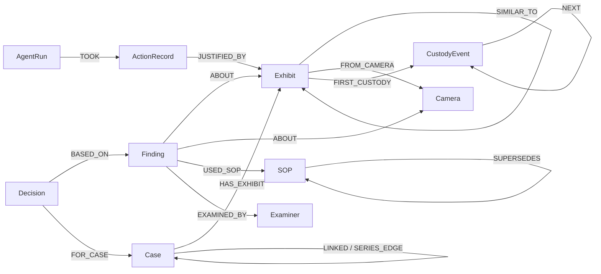

# Coldlink

Coldlink is an agent for a forensic lab. It connects evidence across years of cases, challenges its own conclusions, and decides which examination to request next. Every suggestion carries the evidence path behind it, and a human examiner makes the final call.

Built for **Graph Hacks: Context for AI Agents** (WeMakeDevs x FalkorDB, Oct 15 to 18, 2026). FalkorDB is the primary and only store.

> **All data is synthetic.** The Southern Regional Forensic Lab, its stations, cases, exhibits, examiners and cameras are generated by `coldlink/generate.py`. No real person, victim, case or place is used. People connected to cases exist only as opaque subject references, and the agent never names a suspect.

**Tracks:** 01 Agents That Act on Connected Data, 02 Agent Memory and Coordination, 03 Company Brain.

## Status at submission (Oct 18)

Working: data generator, FalkorDB schema and loader, the seven graph tools in Cypher, an MCP server exposing them, the Lead agent loop, memory revision after a re-test, SOP supersession (Track 03), and two scenarios that end in different actions. The offline run passes all 8 planted-story checks (see [Demo](#demo)).

Not built: Evidence and Statement agents with handoff and restart recovery, tenant demo with a second lab, case view UI, benchmark. The Claude mode of the Lead agent is written but has not yet been run against the API.

**Deployment.** No live deployment. The [Quick start](#quick-start) below is the complete local setup; `docker compose up --build` runs the generator, the loader and the two-scenario demo end to end against a containerized FalkorDB.

**Demo video:** _link to be added_.

## Quick start

Requirements: Docker, Python 3.11+.

```bash
docker compose up -d falkordb            # FalkorDB on :6379, Browser on http://localhost:3000
pip install -r requirements.txt
python -m coldlink.generate               # data/srfl.json: 3,000 cases, ~9,300 exhibits
python -m coldlink.load                   # loads graph coldlink_srfl, derives similarity and links
python -m coldlink.demo --mode offline    # both scenarios, with checks against ground truth
```

Or everything in containers: `docker compose up --build` (runs the offline policy, matching the Demo results below regardless of whether `ANTHROPIC_API_KEY` is set on the host).

To let Claude choose the tools, set `ANTHROPIC_API_KEY` and use `--mode claude` (or `auto`, which picks Claude when a key is set). The model defaults to `claude-sonnet-5-5`; override with `COLDLINK_MODEL`.

Single scenario: `python -m coldlink.agents.lead scenarios/scenario_a.json --mode offline`.

### MCP

```bash
python -m coldlink.mcp_server              # stdio
python -m coldlink.mcp_server --http 8090  # streamable HTTP
```

Claude Desktop / Claude Code config:

```json
{ "mcpServers": { "coldlink": { "command": "python", "args": ["-m", "coldlink.mcp_server"], "cwd": "/path/to/COLDLINK" } } }
```

The official FalkorDB MCP server can run alongside for raw read-only Cypher: `docker compose --profile mcp up`.

## The planted story

| Plant | What is in the data | What the agent must do |
|---|---|---|
| Window series | 7 burglaries, 4 stations, 2020 to 2025: 14 mm flat-chamfered pry-bar, zigzag size-9 sole, white Transit with partial plate KX6, rear first-floor entry 01:00 to 04:00. No evidence type appears in all of them. Examiners linked only 2 (2024-0058 and 2025-0139). | Find all 7 via multi-hop links |
| Undermined alibi | 2023-0155: a subject eliminated by CAM-17 with a 25-minute margin. 2025-0302 (unrelated traffic case) found CAM-17 runs 47 minutes fast. A 2022 decision also rests on CAM-17 but with a 130-minute margin. | Reopen the 2023 decision, leave the 2022 one standing |
| Decoy | 2024-0277: pry-bar 14.2 mm but serrated edge, front door, 14:10 | Score it low and say why |
| Custody gap | 2020-0112's footwear lift: 9 days between dispatch and lab receipt | Hold back any link that rests on it |
| False link | 2021-0264: zigzag size 9 examined under superseded SOP-FW-2 (sub-type not recorded) | Name it as the weakest link, request a re-test; once disproved, exclude it |

## Graph data model

One graph per lab (`coldlink_<lab>`) inside one FalkorDB instance. Cases carry a `sealed` flag that the tools respect.

| Layer | Nodes | Key edges |
|---|---|---|
| Evidence | `Case`, `Exhibit` (+ `ToolMark`, `Footwear`, `Vehicle`, `CCTV`, `DNA`, ...), `Statement`, `Location`, `Station`, `Camera` | `HAS_EXHIBIT`, `HAS_STATEMENT`, `AT`, `REPORTED_AT`, `FROM_CAMERA`, `SIMILAR_TO {etype, score, contra, basis}`, `LINKED {score, support, contra, types, basis, pairs, status, reason}` |
| Reasoning | `Finding`, `Decision`, `Hypothesis` | `ABOUT`, `BASED_ON`, `FOR_CASE`, `LINKS`, `REVISES`, `SUPPORTED_BY`, `CONTRADICTED_BY`, `PART_OF {status}` |
| Institution | `Examiner`, `Method`, `SOP`, `CustodyEvent`, `Lab` | `EXAMINED_BY`, `USED_METHOD`, `USED_SOP`, `SKILLED_IN`, `FOR_METHOD`, `SUPERSEDES`, `FIRST_CUSTODY`, `NEXT` |
| Agent memory | `AgentRun`, `ActionRecord` | `TOOK`, `JUSTIFIED_BY` |
| Projection | | `SERIES_EDGE {cost}`: the `LINKED` edges whose status is `proposed` or `accepted` |

`LINKED.status` is one of `proposed`, `accepted`, `rejected`, `disproved`, `held`. Changing it keeps the reasoning on the edge and adds or removes the `SERIES_EDGE`, so disproved and held links drop out of every later series search.



## Tools and the Cypher behind them

All queries live in [`coldlink/cypher.py`](coldlink/cypher.py); the tools are in [`coldlink/tools.py`](coldlink/tools.py).

| Tool | What it does | Graph feature |
|---|---|---|
| `find_similar_exhibits` | Matches marks, soles and vehicles by class and measurements, including contradicted near-misses | Property match over `SIMILAR_TO` |
| `link_path` | Strongest evidence chain between two cases, with the evidence behind each hop | `algo.SPpaths` over `SERIES_EDGE`, weight `1 - score`, both directions |
| `series_candidates` | Groups cases into likely series, ranked by cohesion | `algo.WCC` over `SERIES_EDGE` |
| `weakest_link` | The link a hypothesis depends on most, discounted by exhibit reliability | Traversal of links to exhibits, findings, SOPs and custody, then scoring |
| `decisions_resting_on` | Every decision built on a source, and whether a known error overturns its margin | Reverse traversal `Decision-[:BASED_ON]->Finding-[:ABOUT\|FROM_CAMERA*1..2]->source` |
| `custody_gaps` | Missing steps in an exhibit's custody chain | Walk along `NEXT` |
| `best_examiner` | Ranks active examiners by hands-on history with a method | Weighted counts over `EXAMINED_BY` and `USED_SOP` |

Supporting tools: `case_summary`, `case_links`, `score_pair`, `cameras_for_cases`, `findings_under_superseded_sop`. Action tools: `request_retest`, `reopen_decision`, `hold_link`, `notify_officer` (recorded only; nothing leaves the graph), `set_link_status`.

**Scoring.** Exhibit similarity and case link scores are computed in Cypher, so the numbers are reproducible. Physical evidence types are independent and add: tool mark 0.40, footwear 0.35, vehicle 0.25, each times its best `SIMILAR_TO` score; same entry point +0.10, start times within 2 hours +0.05. Contradictions are scored separately: a different edge profile 0.30, a different entry point 0.10, start times 6 or more hours apart 0.10. `score = support - contra`, and a link is proposed at 0.35. In `weakest_link`, an exhibit under a superseded SOP multiplies a link by 0.75 and a custody gap sets it to 0.

FalkorDB notes, checked against the docs and the running image: `shortestPath` is only allowed in `WITH`/`RETURN` and not undirected, so `link_path` uses `algo.SPpaths` with `relDirection: 'both'`; `algo.WCC` takes `nodeLabels` and `relationshipTypes`; the default query `TIMEOUT` is 1000 ms (raised in `docker-compose.yml`).

## How the agent chooses

When a case arrives, the Lead agent ingests it (similarity and links are derived against the full history), then calls tools based on what the previous ones returned. The action depends on what the weakest link's weakness is:

- custody gap on the exhibit → `hold_link`, rejecting `request_retest` because a re-test cannot repair custody, and `notify_officer`
- finding under a superseded SOP → `best_examiner` then `request_retest`, rejecting `hold_link` because custody is intact
- a decision whose margin is smaller than a known clock error on its source → `reopen_decision`; decisions whose margin survives are left standing

Every tool call is checkpointed on the `AgentRun` node (`step`, `last_tool`, `last_args`), and every action is an `ActionRecord` with `JUSTIFIED_BY` edges to its evidence, the full `path`, and the rejected alternative with its reason.

`--mode claude` gives Claude the same tool definitions and lets it choose. `--mode offline` is a rule policy over the same tools, used for tests and as the benchmark baseline.

## Demo

`python -m coldlink.demo --mode offline`, measured on the default seed (7):

| Check | Result |
|---|---|
| All 7 planted series cases found | PASS (7/7) |
| Decoy rejected (score -0.425: edge profile, entry and time all contradict) | PASS |
| 2023 elimination reopened (47 min offset ≥ 25 min margin) | PASS |
| 2022 CAM-17 decision left standing (47 min < 130 min) | PASS |
| Scenario A ends in a re-test of the weakest link | PASS |
| After the re-test, the false link is disproved and the series drops from 9 to 8 | PASS |
| Scenario B holds the link instead of re-testing | PASS |
| The held link is the one resting on the custody-gap exhibit | PASS |

These come from synthetic data and from the deterministic offline policy. The background also contains small spurious components (single-type matches); the planted series is the top-ranked candidate by cohesion, but false links in the background have not been measured yet.

**Test of graph dependence.** `python -m coldlink.removal_test` runs scenario A with FalkorDB unreachable. It fails (connection refused): there is no fallback store, because similarity, series, paths, decision dependencies and custody chains are all graph queries.

## AI assistance disclosure

This project was built with Claude Code (Anthropic) as an AI coding assistant. The authors review and can explain every query and agent decision.
